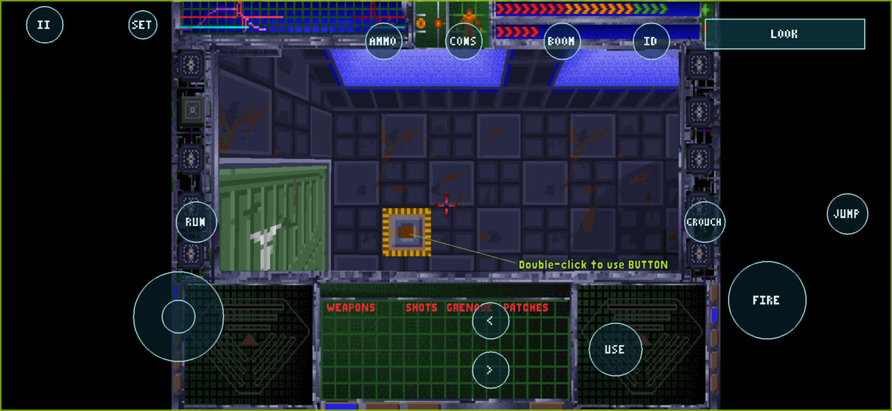

# System Shock Touch Edition

**System Shock (1994) on Android phones, with a complete touchscreen control scheme.** It's an unofficial,
substantially customized build of the [Shockolate](https://github.com/Interrupt/systemshock) source port, based on
[System Shock — Android](https://github.com/raposomiguel50/system-shock-android) by raposomiguel50.

This is the project's official repository. It holds the release source, the downloads, the documentation and the
feature list.

| Looking for… | Go to |
| --- | --- |
| The app | [**Download the APK**](https://github.com/thekojac304/system-shock-android/releases/download/v1.1.0-beta.2/SystemShock-TouchEdition-1.1.0-beta.2-arm64-v8a.apk) (1.1.0-beta.2, 3.7 MB) · [release notes](https://github.com/thekojac304/system-shock-android/releases/tag/v1.1.0-beta.2) |
| What's different from upstream | [What's new in Touch Edition](#whats-new-in-touch-edition) |
| What you can do in the game | [Controls and settings](#controls-and-settings) |
| What's still in development | [Experimental features and research](#experimental-features-and-research) |
| Every feature with its evidence | [docs/FEATURES.md](docs/FEATURES.md) |
| The full engineering history | [system-shock-android-development-history](https://github.com/thekojac304/system-shock-android-development-history) |

Version 1.1.0-beta.2 in game on a Galaxy S26 Ultra (Android 17), 2026-11-10.

## Download

**Current version: [1.1.0-beta.2](https://github.com/thekojac304/system-shock-android/releases/tag/v1.1.0-beta.2)
(beta).** This repository's Releases page is the only official download location.

- APK: [`SystemShock-TouchEdition-1.1.0-beta.2-arm64-v8a.apk`](https://github.com/thekojac304/system-shock-android/releases/download/v1.1.0-beta.2/SystemShock-TouchEdition-1.1.0-beta.2-arm64-v8a.apk) (3.7 MB)
- Checksum: [`SHA256SUMS.txt`](https://github.com/thekojac304/system-shock-android/releases/download/v1.1.0-beta.2/SHA256SUMS.txt) (SHA-256 `d142fb5a…39ad`)
- Needs an ARM64 device with Android 13 or later, and **your own copy of System Shock**. The APK contains no game data.

## What is Touch Edition?

Upstream's System Shock — Android targets controller handhelds such as the Retroid Pocket 5. On those, touch is only an
optional mouse pointer. Touch Edition turns the same engine into a game you can play on a phone with your fingers alone:

- a full on-screen control scheme, built on its own touch input layer;
- a cursor mode that drives the original mouse interface by touch;
- optional radial wheels for weapons, patches and grenades;
- a layout editor, so you can arrange the controls yourself;
- the fixes a phone needs.

It has its own app identity, so it installs beside upstream's app rather than over it.

Everything else is Shockolate's and upstream's work: the engine, the game logic, the original graphics and sound,
controller support and the game-data importer. Touch Edition keeps that work unchanged and builds on top of it.

## What's new in Touch Edition

Everything in this section is **in the downloadable 1.1.0-beta.2 APK**. Work that is not in the APK is listed
separately under [experimental features and research](#experimental-features-and-research).

### Controls

- **A complete touch scheme drawn over the whole screen, including the black side bars:**
  - a floating move stick, and swipe to look;
  - **FIRE** (drag to aim), **USE**, **JUMP**, **CROUCH**;
  - **RUN** (a sprint latch that shows **RUN ON**) and **ID** (target identification);
  - previous/next weapon, **AMMO** (tap to reload, hold to pick an ammo type), **CONS** (patches) and **BOOM** (grenades).

  The overlay hides itself when a game controller is connected.
- **Cursor emulation (LOOK / CURSOR):** cursor mode drives the original mouse interface: the MFDs, inventory, containers
  and the fullscreen toggle.
  - Taps and drags follow the game's own click and double-click rules.
  - The cursor knows what's under your finger, such as a container item, an inventory row or the fullscreen icon.
  - It returns to LOOK after you pick something up in the world.
- **Radial wheels** (optional): hold next-weapon (**>**), CONS or BOOM to pick a weapon slot, patch type or grenade type
  from what you're carrying.
- **Haptics** (optional), at three strengths.
- **Look sensitivity** (separate horizontal and vertical) and **invert Y**.

### Interface and usability

- **Layout editor (SET → EDIT LAYOUT):**
  - move and resize every control;
  - set the overall opacity and the stick size;
  - move the toolbar.

  Layouts survive restarts and app updates. Old settings files are upgraded automatically.
- **Tap to skip** the intro and cutscenes, and **tap to dismiss** the start-up help.
- **Reliable menu taps:** single taps register at once, and a drag isn't mistaken for a click.
- **The MFD minigames** no longer read touch input as a right-click.

### Visuals

- **Visuals option** in the game's Video settings: **VISUALS ORIGINAL** (the default), **VIS1 CONS** (conservative) and
  **VIS1B HORROR**. These are darker, moodier regrades of the original 8-bit lighting, without new art.
  - **This is an early preview.** It only changes the Medical deck's healing-suite area, and everywhere else the game
    keeps its original look.
  - The larger lighting and atmosphere work is not in this APK: see
    [experimental features](#experimental-features-and-research).

### Compatibility and stability

- **Intro movie crash fixed.** The original intro decoder read past the end of its buffers, which crashed on Android.
  The decoded picture is unchanged.
- **16 KB page-size support:** native libraries are aligned for newer Android devices.
- **Import crash on upright phones fixed (beta.2).** The launcher no longer closes when the screen rotates during the
  first game-data import.

### App identity

- Package `io.github.thekojac304.systemshock`, named **System Shock (Touch Edition)**, and signed with this project's
  own key.
- It installs beside upstream's `io.github.raposomiguel50.systemshock`. Updates within Touch Edition keep your imported
  data, saves and touch layout.

## Install and play

1. Download the APK on your Android device and install it. The first time, Android asks you to allow installs from your
   browser or file manager.
2. Open **System Shock (Touch Edition)**.
3. Tap **Select res folder** and pick your System Shock `res` folder, the one that contains `data` and `sound`.
   - The app copies the folder into its private storage.
   - No storage permission, ADB or PC is needed.
4. The game starts. Tap to skip the intro.

**Game data:** the `res` folder of the CD-ROM release or of System Shock: Enhanced Edition. The floppy release isn't
supported. See [compatible game data](docs/GAME_DATA.md).

Keep your original game files. Uninstalling the app deletes its private copy of the game data and its saves. Saves don't
move between Touch Edition and upstream's app automatically.

## Controls and settings

**On-screen controls (default layout)**

| Control | What it does |
| --- | --- |
| Move stick (left) | Walk and strafe; it appears where your thumb lands |
| Right side of the screen | Swipe to look |
| **FIRE** | Fire; drag to aim |
| **USE** | Use or pick up what's in front of you |
| **JUMP** / **CROUCH** | Jump; crouch |
| **RUN** | Sprint latch (shows **RUN ON**) |
| **<** / **>** | Previous / next weapon. Hold **>** for the weapon wheel, if enabled |
| **AMMO** | Tap to reload; hold to choose an ammo type |
| **CONS** / **BOOM** | Use a patch / grenade. Hold for the patch or grenade wheel, if enabled |
| **ID** | Target identification |
| **LOOK / CURSOR** | Switch between looking around and the touch cursor (the cursor shows in amber) |
| **II** | Pause and game menu |
| **SET** | Touch settings and the layout editor |

**SET → TOUCH SETTINGS**

| Setting | Default | Range |
| --- | --- | --- |
| OPACITY | 100% | 25–100% |
| LOOK X / LOOK Y | 1.00 | 0.25–3.00 |
| INVERT Y | OFF | OFF / ON |
| STICK SIZE | 1.00 | 0.60–1.80 |
| **MORE ›** HAPTICS | OFF | OFF / ON, strength 1–3 |
| **MORE ›** WEAPON / CONSUMABLE / EXPLOSIVE WHEEL | OFF | OFF / ON |

- **EDIT LAYOUT** opens the layout editor. Select a control with **<** / **>**, then use **SIZE −/+**, **OPACITY −/+**,
  **MOVE TOOLBAR** or **RESET DEFAULTS**.
- **RESET TOUCH SETTINGS** restores the defaults.
- **SAVE / DONE** keeps your changes, and **CANCEL** discards them.

The game's own settings menu (sound, video, gamma and so on) is upstream's, plus the **Visuals** option above. Game
controllers work as in upstream ([controller reference](docs/CONTROLS.md)).

## Status and testing

**Beta.** The 1.1.0-beta.2 APK was tested on a **Galaxy S26 Ultra (Android 17)** on 2026-11-10:

| Area | Result |
| --- | --- |
| Install, and update over beta.1 | Works |
| Game-data import through the folder picker | Works (143 files, 316 MB) |
| Intro cutscene, main menu, new game, landscape 3D view and HUD | Works |
| Touch movement, action buttons, menu taps, pause menu, keyboard for the new-game name | Works |
| Audio | Starts (48 kHz stereo, not muted). Checked from the system audio state, not by ear |
| Save, force-stop, cold start, load | Works |
| Long play sessions, all decks | Not tested with this APK |
| Retroid Pocket 5 (upstream's reference device) | Not tested with this APK |

The touch layer has about a dozen automated test suites: surface input, gestures, menu taps, cursor targeting,
settings, the editor, the radial wheels and rendering. The settings, layout editor, radial wheels, AMMO button and menu
taps were also checked on hardware during development, with QA builds.

## Known limitations

- **Save names:** save slots can't be named from touch, because the keyboard only opens on the new-game screen. Saves
  work but show a blank name.
- **Device:** Android 13 or later, ARM64 only.
- **Play coverage:** only a short session has been tested with the release APK.
- **Rare development-build issues:** QA builds occasionally showed two problems with no known cause yet:
  - a freeze on a Maintenance elevator, which wasn't reproduced on retest;
  - sound effects arriving slightly late after the app returned from the background.
- **App icon:** it is still the default SDL icon inherited from upstream.
- **Upstream documents:** some files in `docs/`, such as `CONTROLS.md`, `INSTALL.md` and `BUILD.md`, were written for
  upstream and use upstream's package name. See [docs/README.md](docs/README.md).

## Experimental features and research

These exist in the source or the development history but are **not in the downloadable APK**. They are compiled only into
internal QA builds (a `qa` build type with `RP5NP_QA_TOOLS`), or exist only as uncommitted development work. None of
them is promised for a particular release.

| Work | State | Where |
| --- | --- | --- |
| **OpenGL ES 3 world renderer.** It draws the 3D view on the GPU, falls back to the original software renderer when it can't, and matches the original's terrain, objects and special views | Prototype; full parity with the original renderer not reached | QA builds only. `SourceSnapshot/src/MacSrc/GpuWorld.c`; `docs/GPU_RENDER*` |
| **Generated deck lighting.** Light sources are inferred offline from your own game data, then lit on the GPU | 8 of 10 decks lit, with Maintenance and Security getting post-processing only; checked live on a phone | QA builds only; `docs/DECKLIGHT_*`, `docs/HORROR_GENERATED1_QA.txt` |
| **Atmosphere and post-processing.** Vignette, film grain, distance haze and height fog, per-deck mood grades, and flickering that follows the light fixtures | Works in QA builds, bounded per deck | QA builds only (needs the GPU renderer); `docs/HORROR_HYBRID*` |
| **Replacement soundtrack.** Per-deck music, from music files you supply, played instead of the original MIDI, with a fallback to stock music | The engine code is in the APK, but a normal install can't enable it: there is no in-app setting, and no music is supplied | `docs/AUDIO2_SOUNDTRACK_QA.txt` |
| **Dynamic exploration/combat music**, fades and resume position, and per-track loop points | Implemented in development work. Testing on hardware isn't finished | Development history only (`docs/AUDIO3*`, `AUDIO31*`, `AUDIO4*`) |
| **Audio settings page** (master, music, effects and ambience volumes, soundtrack choice) and **enhanced ambience** | Partly implemented. No ambience content exists yet | Development history only (`docs/AUDIO5_MOBILE_POLISH1.md`) |
| **Touch assist** for the original interface's small targets: side icons, inventory tabs and MFD buttons | Implemented in development work; hardware retest pending | Development history only |
| **QA tools.** God mode, full loadout, deck teleport to safe spawn points, and on-screen buttons to compare visual modes | Internal testing aid only | QA builds only (`AndroidProject/app/jni/touch/qa_tools.c`) |
| **Offline lighting-inference research.** Tooling that works out where lights belong from the map data | Research. One gate failed and is recorded as such | `scripts/horror_*.py`; `docs/HORROR_AUTHOR*` |

"Development history only" means the work is in the
[development-history repository](https://github.com/thekojac304/system-shock-android-development-history), on branch
`backup/workspace-preservation-2026-11-10`, and not on this repository's `main`.

## Differences from upstream

| | Upstream System Shock — Android v1.0.0 | Touch Edition 1.1.0-beta.2 |
| --- | --- | --- |
| Target | Controller handhelds (Retroid Pocket 5) | Phones and other touch devices; controllers still work |
| Touch | An optional mouse pointer | Full scheme: stick, look, action buttons, cursor mode, radial wheels, haptics, layout editor |
| Visuals | Original | Original, plus the opt-in Visuals preview |
| Fixes | — | Intro decoder crash, 16 KB alignment, import crash on upright phones, MFD minigame touch |
| Package | `io.github.raposomiguel50.systemshock` | `io.github.thekojac304.systemshock`, own signing key |
| Engine, game logic, importer, controller support, audio | Shockolate and upstream | Unchanged from upstream |

## Source and history

- **This repository** is the official home of Touch Edition. Its `main` holds the complete source of 1.1.0-beta.2.
- **Tag `v1.1.0-beta.2`** is the exact source of the released APK. It is a single snapshot commit of the release line,
  identical to the development tree apart from one redacted device identifier in seven QA notes.
- **Upstream's history** (`0d71a89` and earlier) is kept underneath. The `touch-controls` branch and `touch-baseline` tag
  mark where the touch work began.
- **[system-shock-android-development-history](https://github.com/thekojac304/system-shock-android-development-history)**
  holds every development commit, with device identifiers and local paths redacted. It's a reference archive and
  doesn't offer separate downloads.

## Building from source

You need Windows with PowerShell 7, JDK 17, the Android SDK 34/35 build tools and NDK `29.0.14206865`.

- The full steps are in [docs/BUILD.md](docs/BUILD.md), which was written for upstream: clone this repository and check
  out `v1.1.0-beta.2`.
- The public APK is the `release` build type. The `qa` build type adds the experimental features above.
- Sign release builds with your own key.

## Credits and license

- [Shockolate](https://github.com/Interrupt/systemshock) by Interrupt and contributors: the GPL source port of the
  System Shock engine.
- [System Shock — Android](https://github.com/raposomiguel50/system-shock-android) by raposomiguel50: the Android
  port, importer, controller support, audio integration and release tooling this build starts from. Its original README
  is kept in [docs/UPSTREAM_README.md](docs/UPSTREAM_README.md).
- SDL2 and SDL_mixer: see [THIRD_PARTY_NOTICES.md](THIRD_PARTY_NOTICES.md).

GPL-3.0-or-later ([LICENSE](LICENSE)). System Shock is a trademark of its owners. This build is not affiliated with or
endorsed by Night Dive Studios, Looking Glass Studios or the upstream authors.
